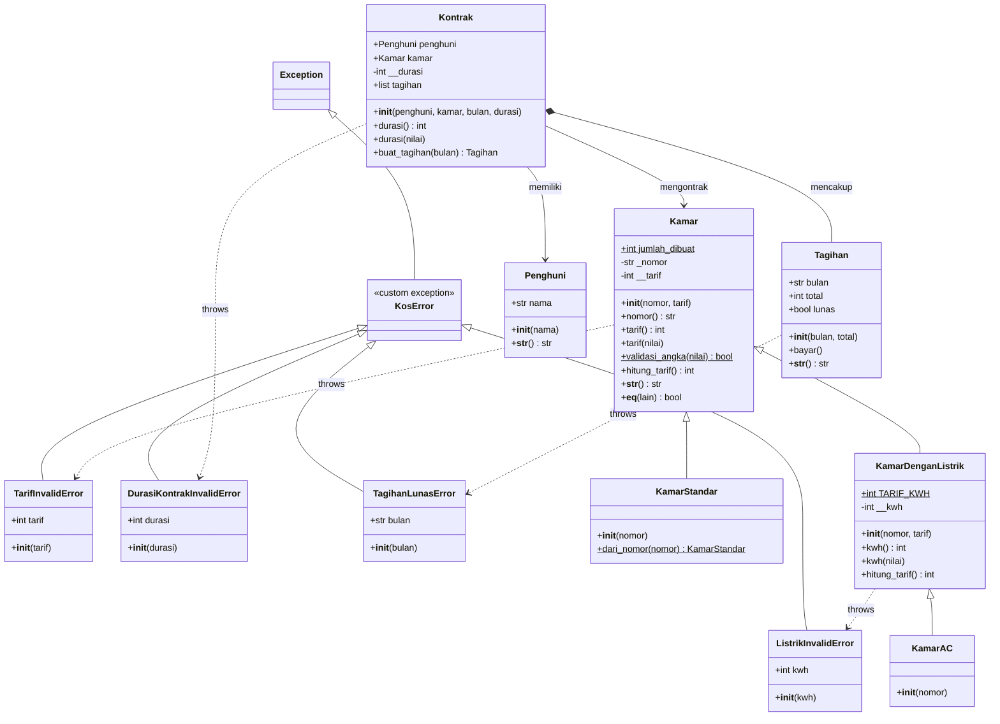

# py-manajemen-kos-kosan UTS PBO
# Sistem Manajemen Kos-Kosan (Pengembangan dengan Exception Handling)

Proyek ini merupakan pengembangan dari tugas Ujian Tengah Semester (UTS) Pemrograman Berorientasi Objek (PBO) dengan menambahkan penanganan pengecualian (*exception handling*) berbasis *custom exception*, validasi aturan bisnis pada *setter* dan *method* domain, serta alur penanganan dengan blok `try`, `except`, `else`, dan `finally`.

---

## 1. Struktur Direktori Proyek

```text
python-pbo/
├── README.md              # Dokumentasi lengkap, aturan bisnis, dan diagram kelas
├── main.py                # Runner utama di root direktori
└── src/
    ├── __init__.py        # Inisialisasi paket Python
    ├── exceptions.py      # Hierarki custom exception
    ├── kamar.py           # Kelas domain kamar (Kamar, KamarStandar, KamarDenganListrik, KamarAC)
    ├── kontrak.py         # Kelas domain kontrak (Penghuni, Tagihan, Kontrak)
    └── main.py            # Program utama demonstrasi skenario penanganan eksepsi
```

---

## 2. Identifikasi Aturan Bisnis

Terdapat 4 aturan bisnis utama yang diterapkan dan divalidasi pada sistem kos-kosan ini:

| No | Aturan Bisnis | Penjelasan Pelanggaran | Custom Exception yang Dilempar |
|---|---|---|---|
| 1 | **Tarif Kamar Harus Positif** | Tarif sewa kamar tidak boleh bernilai nol (`0`), negatif (`< 0`), atau bukan integer. | `TarifInvalidError` |
| 2 | **Pemakaian Listrik Tidak Boleh Negatif** | Jumlah pemakaian daya listrik (dalam satuan kWh) tidak boleh bernilai negatif (`< 0`). | `ListrikInvalidError` |
| 3 | **Durasi Kontrak Sewa Minimal 1 Bulan** | Kontrak sewa kamar harus berdurasi minimal 1 bulan (`durasi >= 1`). Nilai $\le 0$ atau non-integer ditolak. | `DurasiKontrakInvalidError` |
| 4 | **Pencegahan Pembayaran Ganda Tagihan Lunas** | Tagihan yang statusnya sudah lunas (`lunas == True`) tidak dapat dibayarkan kembali untuk mencegah duplikasi pembayaran. | `TagihanLunasError` |

---

## 3. Hierarki Custom Exception (`src/exceptions.py`)

Seluruh *custom exception* diturunkan dari satu *base exception* bernama `KosError`, yang mewarisi kelas bawaan Python `Exception`.

- **`KosError(Exception)`**: Base class untuk seluruh exception pada sistem kos-kosan.
  - **`TarifInvalidError(KosError)`**: Dilempar saat penetapan tarif kamar melanggar aturan bisnis 1.
  - **`ListrikInvalidError(KosError)`**: Dilempar saat penetapan kWh listrik melanggar aturan bisnis 2.
  - **`DurasiKontrakInvalidError(KosError)`**: Dilempar saat durasi kontrak sewa melanggar aturan bisnis 3.
  - **`TagihanLunasError(KosError)`**: Dilempar saat pembayaran tagihan melanggar aturan bisnis 4.

---

## 4. Perubahan Setter dan Method pada Domain

1. **`Kamar.tarif` (Setter di `src/kamar.py`)**
   Menggunakan `raise TarifInvalidError(nilai)` apabila nilai bukan integer positif atau bernilai $\le 0$.
2. **`KamarDenganListrik.kwh` (Setter di `src/kamar.py`)**
   Menggunakan `raise ListrikInvalidError(nilai)` apabila nilai kWh bernilai negatif.
3. **`Kontrak.durasi` (Setter & Constructor di `src/kontrak.py`)**
   Menggunakan `raise DurasiKontrakInvalidError(nilai)` apabila durasi sewa kurang dari 1 bulan.
4. **`Tagihan.bayar()` (Method di `src/kontrak.py`)**
   Menggunakan `raise TagihanLunasError(self.bulan)` apabila method dipanggil saat `self.lunas` bernilai `True`.

---

## 5. Implementasi Blok `try`, `except`, `else`, dan `finally` (`src/main.py`)

Program utama menguji dan mendemonstrasikan secara otomatis:
- **Blok `try`**: Menjalankan instruksi domain yang berpotensi memicu exception.
- **Blok `except`**: Menangkap *custom exception* spesifik dan menampilkan pesan kesalahan ramah pengguna.
- **Blok `else`**: Dijalankan secara eksklusif hanya ketika blok `try` berhasil tanpa ada exception yang dilempar (contoh pada *Happy Path* Skenario 1).
- **Blok `finally`**: Selalu dieksekusi di akhir operasi baik terjadi exception maupun tidak (digunakan untuk *logging* dan pembersihan sesi).

---

## 6. Revisi Diagram Kelas (Class Diagram)

Berikut adalah diagram kelas lengkap yang memuat hierarki kelas domain, relasi antar kelas, hierarki *custom exception*, serta dependensi pelemparan exception (`throws`):



---

## 7. Panduan Menjalankan Program

Jalankan perintah berikut melalui terminal atau command prompt:

```bash
# Menjalankan langsung melalui paket src:
python src/main.py

# Atau menjalankan melalui root runner:
python main.py
```
